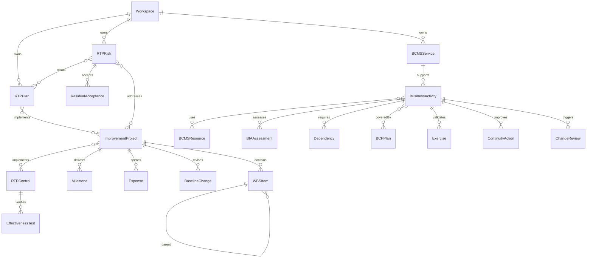

# دیدبان امنیت ۷ — معماری و دامنه اجرا

مبنای تغییر، commit `cdf79ea` از نسخه ۶ و فایل `Didban_Amniat_Offline.html` است. فایل اصلی، موتور React 19.2.6، راهنماهای ۳۰ الزام و ۹۳ کنترل، گزارش Word مبتنی بر قالب، JSZip و سازوکار پروژه‌های قبلی را حفظ می‌کند. چارچوب، سرور یا پایگاه داده جدیدی برای اجرا لازم نیست.

## تصمیم سازگاری با درخواست اصلی

در پرامپت عمومی RTP، PostgreSQL، API، Docker و احراز هویت سرور پیشنهاد شده‌اند. درخواست مستقیم کاربر، اجرای کاملاً آفلاین با بازکردن HTML و حفظ نرم‌افزار موجود است؛ بنابراین این نسخه معماری تک‌فایل را ادامه می‌دهد. هیچ سرور یا PostgreSQL اجرا نمی‌شود؛ API شبکه و مهاجرت پایگاه داده سرور وجود ندارد. معادل خدمات کاربردی و محاسبات در `src/domain.js` و `src/module.jsx` قرار دارد. اعتبارسنجی و کنترل نقش در برنامه محلی است و مرز امنیتی سرور ایجاد نمی‌کند.

## ساختار

| فایل | مسئولیت |
| --- | --- |
| `src/base-v6.html` | منبع تغییرنیافته نسخه ۶ برای ساخت قابل بازتولید |
| `src/domain.js` | خدمات محاسباتی مستقل و قطعی؛ اعتبارسنجی و قواعد تصویب |
| `src/schemas.js` | دفاتر، فیلدها، نقش‌ها، آیکون و زیرمنوهای دو ماژول |
| `src/components.jsx` | فرم، جدول، رادار، پشتیبانی هویت محلی و نمودارها |
| `src/module.jsx` | ثبت، ویرایش، حذف کنترل‌شده، نسخه، تاریخچه و ذخیره اتمی |
| `src/rtp.jsx` | داشبورد، گانت، هشدارها و رادارهای RTP |
| `src/bcms.jsx` | راهنمای ۱۴ مرحله‌ای BIA، داشبورد و مرکز دانش |
| `src/support.jsx` | تنظیمات، گزارش Excel/PDF، JSON و Demo مستقل |
| `src/theme.css` | توکن‌های Light/Dark، RTL، موبایل، چاپ و کاهش حرکت |
| `build.py` | ادغام بررسی‌شده با نسخه ۶؛ تعبیه فونت و کد |

## مدل داده

رابطه فرایند در رکورد فعالیت با نام فرایند ثبت می‌شود. دارایی‌های BCMS از دارایی‌های مدیریت ریسک قدیمی جدا هستند. ریسک‌ها و کنترل‌های RTP نیز نسخه مستقل دارند؛ شناسه Annex A در آن‌ها مرجع است و امتیاز دفتر ممیزی را تغییر نمی‌دهد. هیچ داده RTP یا BCMS در داشبورد اصلی ادغام نمی‌شود.

## نگهداری، مهاجرت و پشتیبان

کلیدهای نسخه ۶ حفظ شده‌اند. دو کلید منطقی جدید `didban-rtp-independent-v1` و `didban-bcms-independent-v1` با همان پیشوند پروژه و namespace قبلی نگهداری می‌شوند. ایجاد پروژه جدید هر دو را خالی می‌سازد. پاک‌کردن پروژه فعال، فقط کلیدهای همان پروژه را پاک می‌کند و نیازمند تأیید عنوان پروژه است.

هر ماژول دارای `records`، `settings`، `revision`، `audit`، `versions` و `snapshots` است. ثبت در localStorage اتمی است؛ در خطای سهمیه، داده قبلی حفظ می‌شود. نسخه ذخیره‌شده پیش از هر نوشتن با نسخه نشست مقایسه می‌شود تا ویرایش تب دیگر بازنویسی نشود. رویداد storage نیز رابط را به‌روز می‌کند. در خرابی داده، ذخیره متوقف می‌شود و اصل کلید دست‌نخورده باقی می‌ماند.

پشتیبان پروژه `didban-security-project-v5` داده‌های نسخه ۶ و هر دو ماژول جدید را دارد. واردکردن پشتیبان قدیمی، دو ماژول را در پروژه واردشده خالی شروع می‌کند. حالت پیش‌فرض import ساخت پروژه جدید است. جایگزینی پروژه فعال با تأیید صریح و امکان rollback انجام می‌شود. پشتیبان ماژولی فقط همان ماژول پروژه فعال را جایگزین می‌کند. Demo قابل import به داده عملیاتی نیست. HTML خام، داده سازمان و هش گذرواژه را در خود ندارد.

## خدمات کاربردی

`V7D` محاسبات MTPD، MBCO، زمان بازیابی، پیشنهاد اختیاری RTO، شکاف RTO/RPO و وابستگی، ارزیابی تمرین، آمادگی، بازنگری، کار انباشته، پیشرفت سلسله‌مراتبی WBS، رادار و کنترل نقش را ارائه می‌کند. زمان‌ها به دقیقه و تاریخ‌های تقویمی به ISO نگهداری می‌شوند. نمایش تاریخ روز رابط، منطقه زمانی تهران را به کار می‌برد.

خدمات UI شامل خواندن ماژول، commit با کنترل revision، ذخیره موجودیت، ثبت تصویب، snapshot، backup و restore هستند. عملیات قبل از ذخیره اعتبارسنجی می‌شود. روابط مورد استفاده مانع حذف رکورد مرجع می‌شوند. رکورد مصوب مستقیماً حذف نمی‌شود. ویرایش محتوای مصوب، نسخه پیشین را نگه می‌دارد و نسخه جدید پیش‌نویس ایجاد می‌کند.

## هویت محلی و محدودیت امنیت

اولین حساب، مدیر سیستم است. گذرواژه با PBKDF2-SHA256 و salt تصادفی و ۱۸۰٬۰۰۰ تکرار نگهداری می‌شود. نشست هویت در حافظه است و با بازخوانی صفحه پایان می‌یابد. نقش‌های مدیر سیستم، مدیر ریسک، مدیر ISMS، مدیر پروژه، مالک ریسک، مدیر واحد، بیننده و ممیز وجود دارند. تصویب نیازمند حساب مجاز است. پذیرش ریسک فقط با حساب نقش مالک ریسک و نام برابر مالک همان ریسک ثبت می‌شود؛ مدیر پروژه و حتی مدیر سیستم جای مالک ریسک پذیرش ثبت نمی‌کنند.

این کنترل‌ها، گردش‌کار آفلاین را سامان می‌دهند؛ شخص دارای دسترسی به فایل، ابزار توسعه مرورگر یا پروفایل دستگاه می‌تواند داده محلی را تغییر دهد. دفتر ممیزی و بخش پشتیبانی نسخه قبلی همچنان در همان دامنه دسترسی محلی هستند. امنیت چندکاربره، جداسازی محرمانگی واحدها، تأیید سمت سرور، تاریخچه غیرقابل‌دستکاری و رمزگذاری داده عملیاتی در این بسته ادعا نمی‌شوند. حساب‌ها و هش‌ها در JSON پروژه صادر نمی‌شوند؛ برای سیستم جدید، حساب‌ها باید در همان دستگاه تعریف شوند. نقش‌های موجود به بخش‌های قدیمی تحمیل نشده‌اند تا گردش‌کار آن‌ها تغییر نکند.

## گزارش و پیوست

گزارش‌های مستقل از داده واقعی و فیلترهای مشخص ساخته می‌شوند. Excel واقعی با JSZip موجود تولید می‌شود؛ مقادیر به‌صورت inline string نوشته می‌شوند و متن کاربر فرمول Excel نمی‌شود. PDF با چاپ مرورگر است. رادار خروجی PNG دارد. پیوست PDF، تصویر و متن با نوع مجاز، بررسی ابتدایی امضای فایل و سقف حجم در JSON تعبیه می‌شود؛ فایل بزرگ به‌صورت مرجع سند ثبت می‌شود. هیچ فایل اجرایی یا HTML پیوست پذیرفته نمی‌شود. ارجاع سند اجرا نمی‌شود. متن‌ها با React escape می‌شوند.

## قابلیت‌هایی که این بسته ادعا نمی‌کند

* سرور، PostgreSQL، Docker، REST شبکه، ایمیل و همگام‌سازی چند دستگاه.
* RBAC امن در برابر دستکاری دستگاه و جداسازی امنیتی واحدها.
* مسیر بحرانی CPM، SPI یا CPI استنتاج‌شده از درصد پیشرفت.
* ترجمه کامل رابط به انگلیسی؛ رابط فارسی با اصطلاحات انگلیسی و نمایش درست RTL/LTR است.
* تشخیص بدافزار در پیوست یا امضای دیجیتال تأییدکنندگان.

امکانات اصلی ثبت، ارتباط موجودیت‌ها، محاسبات، گردش تصویب محلی، تاریخچه، داشبورد، گزارش، Demo و انتقال پشتیبان در همین بسته کار می‌کنند. برای مرحله سروری آینده می‌توان همین خدمات قطعی و مدل داده را بدون تغییر تعریف شاخص‌ها به backend منتقل کرد.
